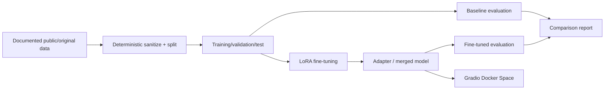

# TinyDevAssist — tiny developer-support language model

A reproducible small-language-model engineering portfolio project. **Status: Python development scaffold implemented; training, evaluation, and deployment have not run.**

## Goal
Adapt `HuggingFaceTB/SmolLM2-360M-Instruct` using LoRA for concise answers to developer-support questions about Git, Python, HTTP APIs, and backend debugging. Compare it with the unchanged base model, then publish a model card and CPU-friendly Gradio Docker Space.

## Architecture



See [architecture](docs/architecture.md), [decisions](docs/decisions.md), and [execution milestones](docs/execution.md).

## Reproducibility and limitations

The exact dataset source, licenses, dependency versions, performance, artifacts, and commands will be documented and verified in subsequent milestones. **Do not treat this repository as a trained or deployed model yet.** No secrets, checkpoints, model weights, or personal support transcripts belong in Git.

## Usage

Setup, preparation, training, evaluation, inference, demo, and deployment commands will be added as their implementations are tested. Python 3.11 is the target environment; CUDA is optional for training, while CPU inference is the target for the hosted demo.

## Development environment (Milestone 2)

Python **3.11** is the target for the ML workflow. A lightweight, importable Python package and offline environment diagnostic are now available. See [developer setup](docs/development.md) for WSL2/Linux instructions and quality gates.

```bash
python3.11 -m venv .venv
source .venv/bin/activate
python -m pip install -e '.[dev]'
python -m tinydevassist doctor
make check
```

The `dev`, `train`, and `app` dependency groups are defined in `pyproject.toml`; ML compatibility and lockfile generation await real hardware validation. CI runs lint, formatting, and dependency-free tests only. **No fine-tuning, evaluation, or deployment has happened yet.**
