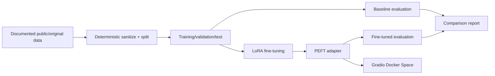

# TinyDevAssist — tiny developer-support language model

A reproducible small-language-model engineering portfolio project. **Status: bounded CPU baseline, six-step LoRA training, held-out comparison, text inspection, and a local Gradio smoke test completed. The [adapter is public](https://huggingface.co/saman-shahroudi/tinydevassist); the Space is blocked by a Hugging Face PRO subscription requirement.**

## Goal
Adapt `HuggingFaceTB/SmolLM2-360M-Instruct` using LoRA for concise answers to developer-support questions about Git, Python, HTTP APIs, and backend debugging. Compare it with the unchanged base model, then publish a model card and CPU-friendly Gradio Docker Space.

## Architecture



See [architecture](docs/architecture.md), [decisions](docs/decisions.md), and [execution milestones](docs/execution.md).

## Reproducibility and limitations

The [seed dataset card](data/DATASET_CARD.md) documents 36 project-authored examples and their license; [model selection](docs/model_selection.md) documents verified upstream metadata. One bounded CPU adapter-training run and paired evaluation are recorded below; they do not establish generalization or production suitability. Public deployment has not been verified. No secrets, checkpoints, model weights, or personal support transcripts belong in Git.

## Usage

The commands below cover data preparation, baseline inference, training, evaluation, and the local demo. The [deployment guide](docs/deployment.md) gives the publication steps. Python 3.11 is the measured environment; CUDA is optional for training, while CPU inference is the target for the hosted demo.

## Development environment (Milestone 2)

Python **3.11** is the target for the ML workflow. A lightweight, importable Python package and offline environment diagnostic are now available. See [developer setup](docs/development.md) for WSL2/Linux instructions and quality gates.

```bash
python3.11 -m venv .venv
source .venv/bin/activate
python -m pip install -e '.[dev]'
python -m tinydevassist doctor
make check
```

The `dev`, `train`, and `app` dependency groups are defined in `pyproject.toml`. The measured CPU run used the versions recorded in [training](docs/development.md) and [evaluation](docs/evaluation.md); these are not a cross-platform lockfile. CI runs lint, formatting, and lightweight tests without downloading model weights.

## Seed data (Milestone 3)

The tracked [`data/samples/developer_support_v1.jsonl`](data/samples/developer_support_v1.jsonl) contains **36 illustrative Q&A records** (6 each for Git, Python, HTTP, APIs, debugging, and operations). These were drafted for this project with language-model assistance, are not real support incidents, and require technical review. See [data provenance and license](data/DATASET_CARD.md). The preparation script now creates deterministic, category-stratified train/validation/test splits; outputs are intentionally ignored by Git.

The base model is [SmolLM2-360M-Instruct](https://huggingface.co/HuggingFaceTB/SmolLM2-360M-Instruct), which the upstream card labels Apache-2.0. It was loaded at the pinned revision and measured on six held-out prompts in one CPU environment, as reported below.

## Dataset preparation (Milestone 4)

After the editable installation above, run:

```bash
python prepare_data.py --seed 42
# Or: make prepare
python -m pytest -q
```

The CLI writes ignored `data/processed/{train,validation,test}.jsonl` files and a
`data/processed/manifest.json` containing source/output SHA-256 hashes, IDs, category counts,
and the seed. With the tracked 36-record dataset, the split is **24 train / 6 validation / 6 test**,
with each of the six categories represented **4/1/1**. Run the same command to reproduce the
bytes; `--input` and `--output-dir` override paths. Validation and test examples must not be
used for training.

The training records include `messages` in role/content format. Later stages must apply the
**base tokenizer's actual chat template**; the preparation script does not inject model-specific
chat tokens. See [data preparation and leakage policy](data/README.md) and
[decision ADR-009](docs/decisions.md). This seed set is illustrative and **does not provide
independent evidence of generalization**.

## Baseline inference and notebooks (Milestone 5 implementation)

Run on a computer with Python 3.11, enough memory, and model access:

```bash
python -m pip install -e '.[train,notebooks]'
python prepare_data.py --seed 42
python inference.py --device cpu --max-samples 6 --max-new-tokens 96 --temperature 0
# Output (only after a successful run): outputs/baseline.json
```

To make results reproducible, pass `--revision <upstream-commit-sha>` rather
than floating `main`. The CLI records each actual response, input/generated
counts, latency, model parameter count/bytes, process RSS snapshots when
`psutil` is installed, and CUDA peak allocation when applicable. It does **not**
claim CPU peak memory. Outputs are Git-ignored. The test prompts are held out
from the 24-row training split; the six questions are not an independent
benchmark and do not establish generalization.

[Notebook 01](notebooks/01_dataset_exploration.ipynb) executes reproducible
seed-data exploration and plots. [Notebook 02](notebooks/02_baseline_model.ipynb)
provides an opt-in baseline run and report inspection. See [notebook guide](notebooks/README.md),
[developer setup](docs/development.md), and [decision records](docs/decisions.md).

**Measured baseline status:** completed twice in one CPU environment
on 2026-10-27. The pinned revision
`a10cc1512eabd3dde888204e902eca88bddb4951` generated all six held-out test
prompts with greedy decoding (96 maximum new tokens) on Python 3.11.16 and
PyTorch 2.14.1+cpu. The first report recorded a 14.303-second median generation
latency and 12.301-second mean latency. A matching baseline rerun used for the
paired comparison recorded 10.793-second median and 9.520-second mean latency.
The baseline contained 361,821,120 unique model parameters
(1,447,284,480 parameter bytes). These are one-machine CPU measurements, not
a quality evaluation or a general deployment performance claim. The generated
report is intentionally ignored; its held-out-input SHA-256 is
`706756348bd549ee3db4f453189955b84950760a723751fd287b37134566dde7`.


## LoRA fine-tuning (Milestones 6–7)

The training implementation is now available at
[`train_lora.py`](train_lora.py) and [`src/tinydevassist/training.py`](src/tinydevassist/training.py),
with configuration in [`configs/train_lora.json`](configs/train_lora.json).
Run `python prepare_data.py --seed 42` followed by `python train_lora.py`
to validate hashes and print a **dry-run plan** without model downloads.
Training requires an explicit `--execute`, a pinned 40-character upstream
revision, a matching **measured** baseline on all six held-out test questions,
and installed ML dependencies.

One bounded CPU run completed on 2026-10-27 at the same pinned revision. It
trained 819,200 LoRA parameters for six optimizer steps over one epoch on the
24-row training split; the six-row validation loss was 3.39398. Training took
43.537 seconds at 0.138 steps/second on Python 3.11.16 and PyTorch 2.14.1+cpu.
The adapter and raw report are Git-ignored. This confirms only that the guarded
pipeline executed; it is not a quality comparison, generalization result, or
deployment claim.

[`03_lora_finetuning.ipynb`](notebooks/03_lora_finetuning.ipynb) explores the
verified plan and reads genuine results only if they exist. The default notebook
execution does not train. See [training instructions](docs/development.md).

## Held-out comparison (Milestone 8)

[`evaluate.py`](evaluate.py) reuses the matching base-model report and runs the
adapter on all six held-out prompts at the same pinned model revision. The
measured CPU comparison produced six nonempty outputs from each model; mean
generation latency was 9.520 seconds for the base and 10.301 seconds for the
adapter. This is execution evidence only, not a quality winner: see the
[evaluation protocol and limitations](docs/evaluation.md).
The [six-response text review](docs/qualitative_review.md) records concrete
failure cases, including fabricated API usage and misleading Git advice.

## Local demo and deployment

Install the app dependencies with `python -m pip install -e '.[app]'`, set
`TINYDEVASSIST_ADAPTER_PATH=checkpoints/tinydevassist-lora`, and run
`python app.py`. The Gradio interface accepts a question and bounded
temperature/token controls; `python smoke.py` checks its HTTP endpoint and
generates one answer. The CPU Docker Space package, model card, exact publish
steps, and current hosting blocker are in the [deployment guide](docs/deployment.md).
The [public adapter repository](https://huggingface.co/saman-shahroudi/tinydevassist)
was verified anonymously. No public Space or hosted inference is claimed.

The CI repair passed [GitHub Actions](https://github.com/samanshahroudi/tinydevassist/actions/runs/40577541798).

## Reproduce the measured experiment

On Python 3.11 with the `train` extra installed, use the pinned upstream
revision below. These commands produce ignored artifacts and require model
downloads and sufficient CPU memory; the baseline, training, and evaluation
CLIs refuse to overwrite existing reports or adapter directories.

```powershell
python prepare_data.py --seed 42
python inference.py --revision a10cc1512eabd3dde888204e902eca88bddb4951 --device cpu
python train_lora.py --revision a10cc1512eabd3dde888204e902eca88bddb4951 --execute
python evaluate.py --revision a10cc1512eabd3dde888204e902eca88bddb4951 --device cpu
```

The tracked 36-row seed should produce source SHA-256
`92ffc379ffe09d71052d9a7cfc9c9b4fe740c540cb7955e4347e2f646bef151f`
and train/validation/test split counts of 24/6/6. The test split SHA-256 is
`706756348bd549ee3db4f453189955b84950760a723751fd287b37134566dde7`.
CI checks these hashes through the deterministic preparation test, along with
linting, formatting, and lightweight unit tests. The published adapter and
model card are [on Hugging Face](https://huggingface.co/saman-shahroudi/tinydevassist).

## CV summary and next improvements

**CV-ready summary:** Built a reproducible CPU developer-support language-model
experiment using a 36-example project-authored Apache-2.0 seed, deterministic
24/6/6 data splits, six-step LoRA adaptation of SmolLM2-360M-Instruct,
paired held-out evaluation, offline CI checks, and a public PEFT adapter
with model card.

Next improvements are an independently authored evaluation set with expert
ratings, longer training only after that evaluation exists, and a hosted demo
when Hugging Face Space entitlement is available. The present six held-out
answers show concrete errors and do not support a quality-improvement claim.
