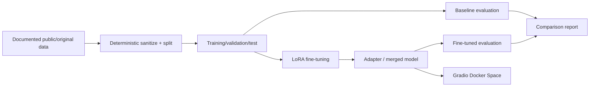

# TinyDevAssist — tiny developer-support language model

A reproducible small-language-model engineering portfolio project. **Status: Milestone 5 implementation checkpoint — baseline inference code and notebooks added; real baseline measurements, training, evaluation, and deployment have not run.**

## Goal
Adapt `HuggingFaceTB/SmolLM2-360M-Instruct` using LoRA for concise answers to developer-support questions about Git, Python, HTTP APIs, and backend debugging. Compare it with the unchanged base model, then publish a model card and CPU-friendly Gradio Docker Space.

## Architecture



See [architecture](docs/architecture.md), [decisions](docs/decisions.md), and [execution milestones](docs/execution.md).

## Reproducibility and limitations

The [seed dataset card](data/DATASET_CARD.md) documents 36 project-authored examples and their license; [model selection](docs/model_selection.md) documents verified upstream metadata. Dependency versions, performance, and runtime artifacts still require verification. **Do not treat this repository as a trained or deployed model yet.** No secrets, checkpoints, model weights, or personal support transcripts belong in Git.

## Usage

Training, evaluation, inference, demo, and deployment commands will be added as their implementations are tested. Python 3.11 is the target environment; CUDA is optional for training, while CPU inference is the target for the hosted demo.

## Development environment (Milestone 2)

Python **3.11** is the target for the ML workflow. A lightweight, importable Python package and offline environment diagnostic are now available. See [developer setup](docs/development.md) for WSL2/Linux instructions and quality gates.

```bash
python3.11 -m venv .venv
source .venv/bin/activate
python -m pip install -e '.[dev]'
python -m tinydevassist doctor
make check
```

The `dev`, `train`, and `app` dependency groups are defined in `pyproject.toml`; ML compatibility and lockfile generation await real hardware validation. CI runs lint, formatting, and dependency-free tests only. **No fine-tuning, evaluation, or deployment has happened yet.**

## Seed data (Milestone 3)

The tracked [`data/samples/developer_support_v1.jsonl`](data/samples/developer_support_v1.jsonl) contains **36 illustrative Q&A records** (6 each for Git, Python, HTTP, APIs, debugging, and operations). These were drafted for this project with language-model assistance, are not real support incidents, and require technical review. See [data provenance and license](data/DATASET_CARD.md). The preparation script now creates deterministic, category-stratified train/validation/test splits; outputs are intentionally ignored by Git.

The candidate base model is [SmolLM2-360M-Instruct](https://huggingface.co/HuggingFaceTB/SmolLM2-360M-Instruct), which the upstream card labels Apache-2.0. This workspace has not downloaded or executed the model; its latency and memory footprint remain unmeasured.

## Dataset preparation (Milestone 4)

After the editable installation above, run:

```bash
python prepare_data.py --seed 42
# Or: make prepare
python -m pytest -q
```

The CLI writes ignored `data/processed/{train,validation,test}.jsonl` files and a
`data/processed/manifest.json` containing source/output SHA-256 hashes, IDs, category counts,
and the seed. With the tracked 36-record dataset, the split is **24 train / 6 validation / 6 test**,
with each of the six categories represented **4/1/1**. Run the same command to reproduce the
bytes; `--input` and `--output-dir` override paths. Validation and test examples must not be
used for training.

The training records include `messages` in role/content format. Later stages must apply the
**base tokenizer's actual chat template**; the preparation script does not inject model-specific
chat tokens. See [data preparation and leakage policy](data/README.md) and
[decision ADR-009](docs/decisions.md). This seed set is illustrative and **does not provide
independent evidence of generalization**.

## Baseline inference and notebooks (Milestone 5 implementation)

Run on a computer with Python 3.11, enough memory, and model access:

```bash
python -m pip install -e '.[train,notebooks]'
python prepare_data.py --seed 42
python inference.py --device cpu --max-samples 6 --max-new-tokens 96 --temperature 0
# Output (only after a successful run): outputs/baseline.json
```

To make results reproducible, pass `--revision <upstream-commit-sha>` rather
than floating `main`. The CLI records each actual response, input/generated
counts, latency, model parameter count/bytes, process RSS snapshots when
`psutil` is installed, and CUDA peak allocation when applicable. It does **not**
claim CPU peak memory. Outputs are Git-ignored. The test prompts are held out
from the 24-row training split; the six questions are not an independent
benchmark and do not establish generalization.

[Notebook 01](notebooks/01_dataset_exploration.ipynb) executes reproducible
seed-data exploration and plots. [Notebook 02](notebooks/02_baseline_model.ipynb)
provides an opt-in baseline run and report inspection, but currently has **no
real model generations**. See [notebook guide](notebooks/README.md),
[developer setup](docs/development.md), and [decision records](docs/decisions.md).

**Measured baseline status:** blocked in the isolated workspace: Transformers
is not installed, Hugging Face is unreachable, and model weights are not cached.
No performance or quality results have been recorded. The next requirement is
to run the baseline successfully on an accessible CPU/GPU machine before
claiming Milestone 5's measurement objective is complete.


## LoRA training implementation (Milestone 6 checkpoint)

The training implementation is now available at
[`train_lora.py`](train_lora.py) and [`src/tinydevassist/training.py`](src/tinydevassist/training.py),
with configuration in [`configs/train_lora.json`](configs/train_lora.json).
Run `python prepare_data.py --seed 42` followed by `python train_lora.py`
to validate hashes and print a **dry-run plan** without model downloads.
Training requires an explicit `--execute`, a pinned 40-character upstream
revision, a matching **measured** baseline on all six held-out test questions,
and installed ML dependencies. No actual training has been verified.

[`03_lora_finetuning.ipynb`](notebooks/03_lora_finetuning.ipynb) explores the
verified plan and reads genuine results only if they exist. The default notebook
execution does not train. See [training instructions](docs/development.md).
